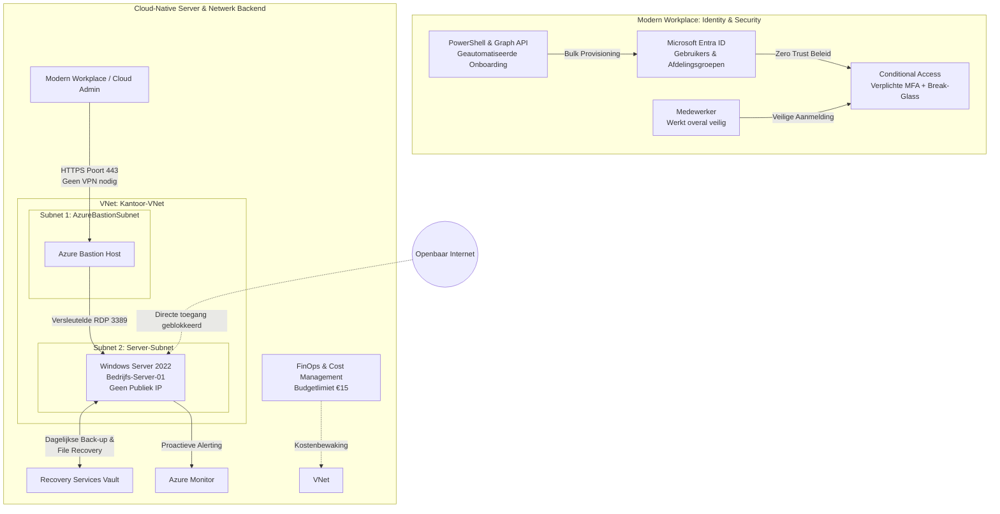
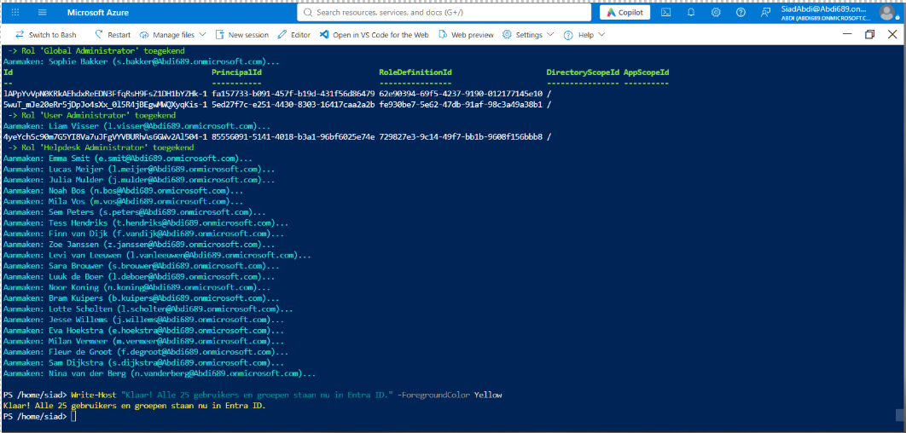
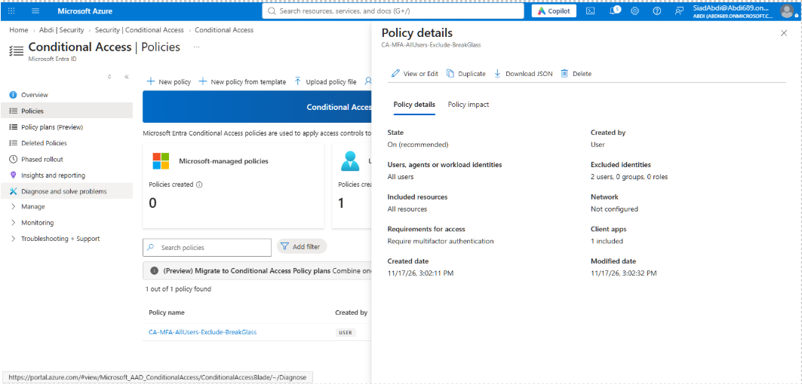
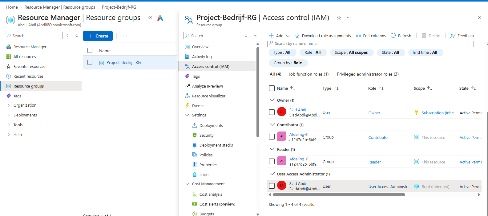
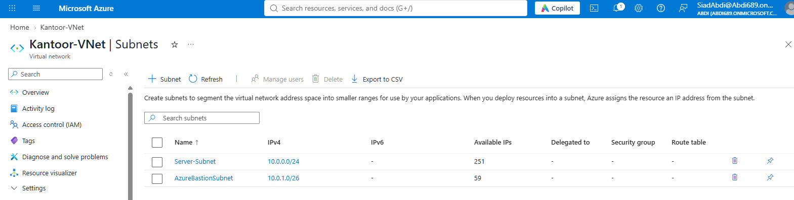
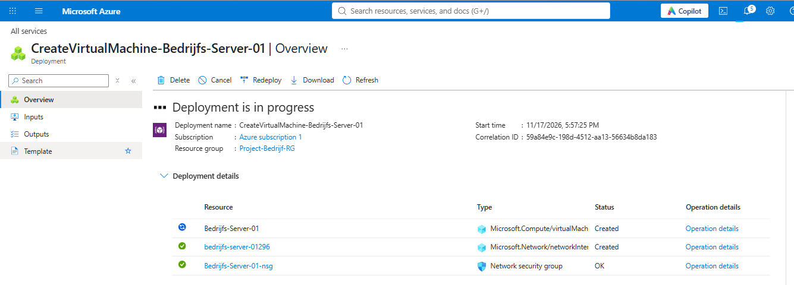
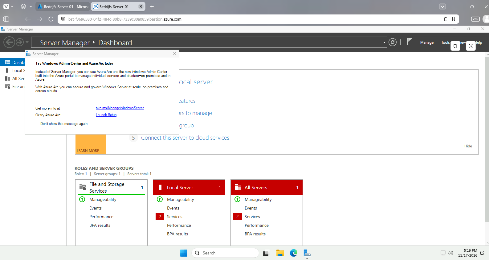
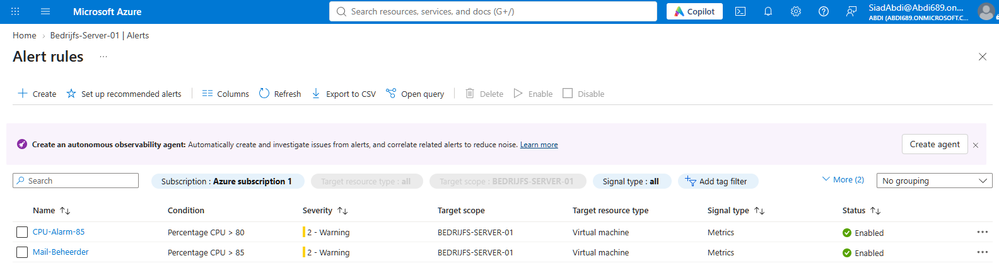
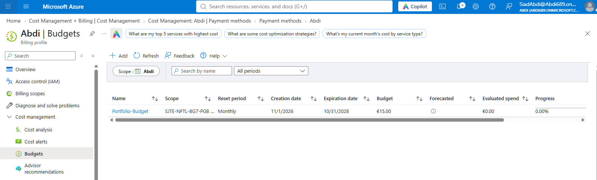

# Modern Workplace & Cloud-Native Bedrijfsinfrastructuur (Microsoft Azure & Entra ID)

## Overzicht & Visie op Modern Workplace
In dit praktijkproject heb ik een complete, veilige en schaalbare **Modern Workplace**-omgeving ontworpen en gebouwd met **Microsoft Entra ID** en **Microsoft Azure**. 

Het doel van dit project is om aan te tonen hoe organisaties overstappen van traditioneel, locatiegebonden IT-beheer naar een **Cloud-Native werkplek** op basis van **Zero Trust-principes**. Medewerkers en beheerders kunnen veilig vanaf elke locatie werken, terwijl bedrijfsdata en ondersteunende servers maximaal zijn afgeschermd tegen cyberdreigingen.

### Kerncompetenties in dit project
* **Identity-First Security & Zero Trust:** Geautomatiseerde onboarding van gebruikers, Multi-Factor Authentication (MFA) via Conditional Access en noodtoegang via *Break-Glass* accounts.
* **Infrastructure as Code (IaC) & Automatisering:** Herhaalbare en foutloze uitrol met **PowerShell (Microsoft Graph)** en **Azure Bicep**.
* **Veilige Cloud-Infrastructuur:** Ondersteunende applicatieservers zonder blootstelling aan het publieke internet, beheerd via **Azure Bastion**.
* **Continuïteit & FinOps:** Geautomatiseerde back-ups, noodherstel (*Disaster Recovery*), proactieve monitoring en strikt kostenbeheer.

---

## Architectuurdiagram (Modern Workplace & Cloud Backend)

---

## Gebruikte Scripts & Infrastructure as Code
* **[scripts/Import-EntraUsers.ps1](scripts/Import-EntraUsers.ps1)** – PowerShell-script (Microsoft Graph) voor geautomatiseerde gebruikersaanmaak en toewijzing van afdelingskenmerken.
* **[scripts/gebruikers.csv](scripts/gebruikers.csv)** – Gestandaardiseerde HR-bronlijst voor de onboarding van nieuwe medewerkers.
* **[scripts/main.bicep](scripts/main.bicep)** – Declaratieve Bicep-code voor de uitrol van het gesegmenteerde netwerk, de afgeschermde server en Azure Bastion.

---

## 1. Identity Governance & Zero Trust Werkplekbeveiliging
* **Geautomatiseerde Onboarding:** Via PowerShell en Microsoft Graph worden nieuwe medewerkers snel en foutloos aangemaakt met direct de juiste functie- en afdelingsgegevens.
* **Conditional Access & Break-Glass Strategie:** Alle gebruikers zijn verplicht om zich te verifiëren met MFA. Tegelijkertijd zijn twee *Break-Glass* noodaccounts uitgesloten van dit beleid volgens Microsoft Best Practices.

**Geautomatiseerd aangemaakte gebruikers in Microsoft Entra ID:**

**Zero Trust Conditional Access beleid (MFA verplicht + Break-Glass uitsluiting):**

---

## 2. Veilige Cloud-Backend & Beheer op Afstand (Azure Bastion)
* **Netwerksegmentatie:** Het virtuele netwerk (`Kantoor-VNet`) is opgesplitst in een apart `Server-Subnet` en een `AzureBastionSubnet`.
* **Zero Exposure (Geen Publiek IP):** De server (`Bedrijfs-Server-01`) heeft géén publiek IP-adres. Poort 3389 (RDP) is volledig onbereikbaar vanaf het openbare internet.
* **Beheer via de Browser:** Beheerders maken zonder VPN veilig verbinding via **Azure Bastion** over versleuteld HTTPS-verkeer (poort 443).

**Netwerksegmentatie met gescheiden subnetten:**

**Windows Server zonder publiek IP-adres (afgeschermd van internet):**

**Veilige beheersessie via Azure Bastion (HTTPS):**

---

## 3. Bedrijfscontinuïteit, Monitoring & FinOps
* **Disaster Recovery & File Recovery:** De server is gekoppeld aan een *Recovery Services Vault*. Een verwijderd financieel document (`Jaarcijfers-Financien.txt`) is succesvol hersteld vanaf een herstelschijf.
* **Proactieve Monitoring:** Via *Azure Monitor* stuurt een waarschuwingsregel (`CPU-Alarm-85`) direct een melding bij hoge systeembelasting.
* **FinOps & Kostenbeheer:** Met *Azure Cost Management* is een budgetlimiet van €15 ingesteld. Na afronding zijn alle test-resources opgeruimd.

**Proactieve waarschuwingsregel in Azure Monitor:**

**Kostenbewaking via Azure Cost Management:**

